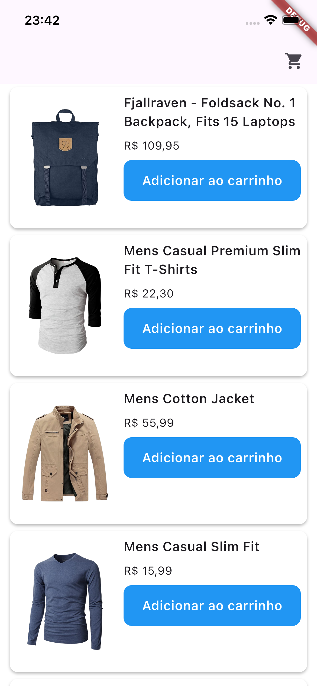
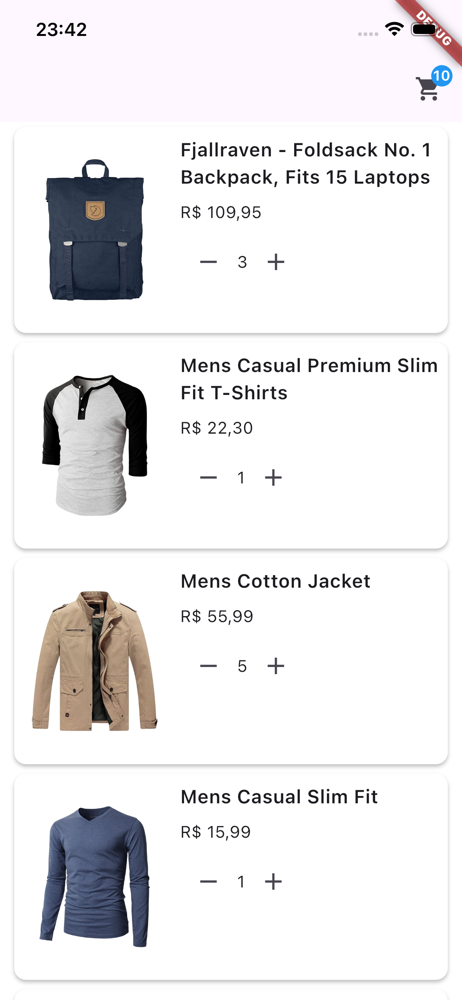
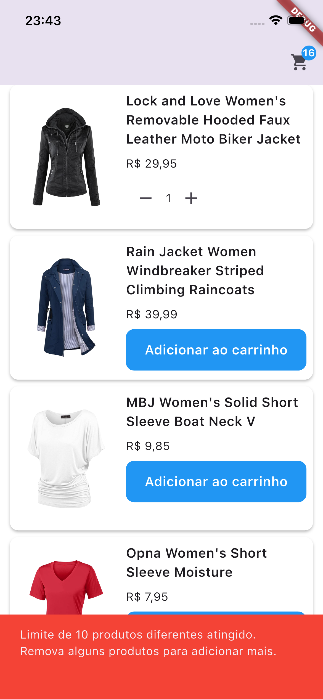
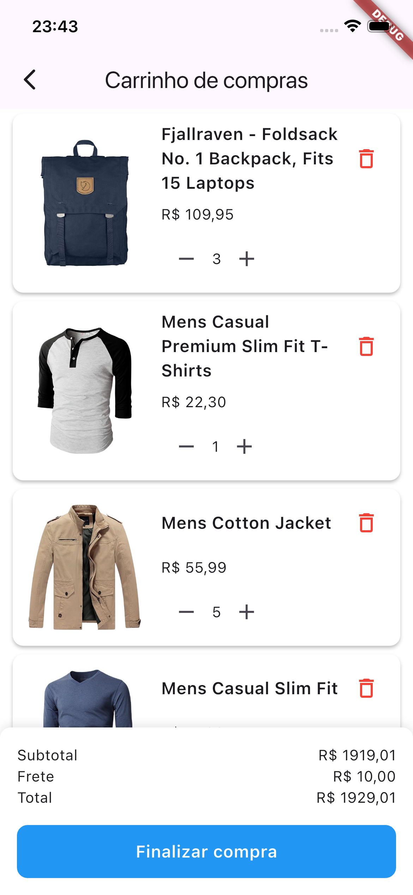
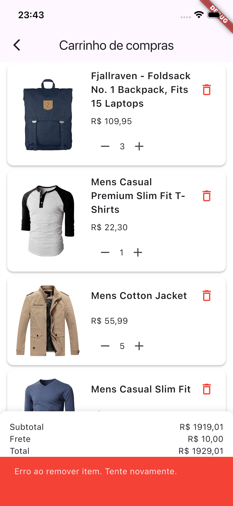
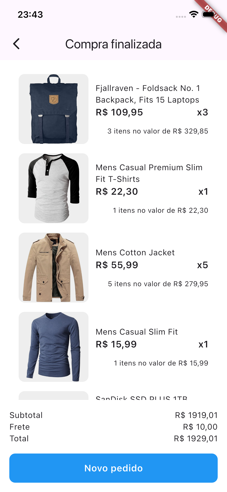

# Shopping Cart - Flutter MVVM

Aplicação de carrinho de compras em Flutter com **MVVM**, use cases e Result pattern. Sample de estudo/portfolio — não é um app de produção.

[](https://www.linkedin.com/in/renansantosbr)

## Requisitos

- Dart SDK `^3.10.1` (ver `pubspec.yaml`)
- Flutter 3.x no canal **stable**

## Como executar

```bash
flutter pub get
flutter run
```

## Como testar

```bash
flutter pub get
flutter test
```

A suíte é unitária + widget. Não há cobertura percentual publicada — rode `flutter test` para ver o resultado atual.

CI pretendido (GitHub Actions, Flutter **stable**, em push e pull request):

```yaml
name: test
on:
  push:
  pull_request:
jobs:
  test:
    name: flutter test
    runs-on: ubuntu-latest
    steps:
      - uses: actions/checkout@v4
      - uses: subosito/flutter-action@v2
        with:
          channel: stable
          cache: true
      - run: flutter pub get
      - run: flutter test
```

O arquivo correspondente é `.github/workflows/test.yml`.

## Arquitetura

MVVM com domínio extraído em use cases. Fluxo:

```
View (widgets)  -->  ViewModel (ChangeNotifier / Provider)
                         |
                    Use cases (regra de negócio)
                         |
                    Repository (porta)  -->  Data (Dio / FakeStore API)
```

- **Model**: entidades de domínio (`Product`, `Cart`, `CartItem`, `Rating`)
- **View**: telas e widgets. Recebem dados por props/Provider e emitem callbacks. Não conhecem Dio.
- **ViewModel**: orquestra o fluxo e o estado da UI (`HomeViewmodel`, `CartStoreViewmodel`)
- **Use cases**: regra isolada e testável (`AddItemToCartUseCase`, `UpdateItemQuantityUseCase`)
- **Repository**: abstração de dados. Implementações em `lib/data/`

Não é Clean Architecture completa (não há packages por feature, nem camada de data sources). É MVVM + use cases + repositório, suficiente para este sample.

## Tecnologias

- Flutter + Provider (`ChangeNotifier`)
- Dio (HTTP)
- Mockito (testes)
- [FakeStore API](https://fakestoreapi.com) (catálogo)

## Funcionalidades

- Listagem de produtos da API
- Adicionar, incrementar, decrementar e remover itens
- Limite de 10 **produtos diferentes** no carrinho (`AppConstants.maxItems`)
- Subtotal, frete fixo (R$ 10,00) e total
- Finalização de pedido (checkout simulado)
- Loading e erro (SnackBar)

## Screenshots

<div align="center">
  
  
  
</div>

<div align="center">
  
  
  
</div>

## Estrutura

```
lib/
├── core/              # constantes, tema, Result, exceções, Dio
├── data/              # repositories + DTOs
├── domain/
│   ├── models/
│   └── usecases/
├── viewmodels/
├── views/
└── shared/            # widgets reutilizáveis
test/
├── domain/usecases/
├── viewmodels/
└── views/
```

## Padrões

### Result pattern

Operações retornam `Result<T>` (`Ok` | `Error`) em vez de lançar exceção para o caller. O ViewModel faz `switch` e atualiza a UI.

### Use cases

- `AddItemToCartUseCase` — adiciona ou incrementa; recusa o 11º produto diferente
- `UpdateItemQuantityUseCase` — incrementa/decrementa; remove o item quando a quantidade chega a zero

### Outros

- Repository pattern
- DI via Provider
- Modelos com `copyWith`
- Estado da UI com `ChangeNotifier`

## O que os testes cobrem

| Área | Arquivo | O que valida |
|---|---|---|
| HomeViewModel | `test/viewmodels/home/home_viewmodel_test.dart` | loading, sucesso, erro, lista imutável |
| CartStoreViewmodel | `test/viewmodels/cart/cart_store_viewmodel_test.dart` | add/increment/decrement, limite, remove, checkout |
| Use cases | `test/domain/usecases/*` | regras de carrinho sem Flutter |
| HomeView | `test/views/home/home_view_test.dart` | widget: loading, vazio, sucesso, erro (SnackBar) |

Repositórios concretos e telas de carrinho/pedido **não** têm testes ainda.

Mocks gerados com Mockito (`build_runner`). Depois de alterar `@GenerateMocks`:

```bash
dart run build_runner build --delete-conflicting-outputs
```
